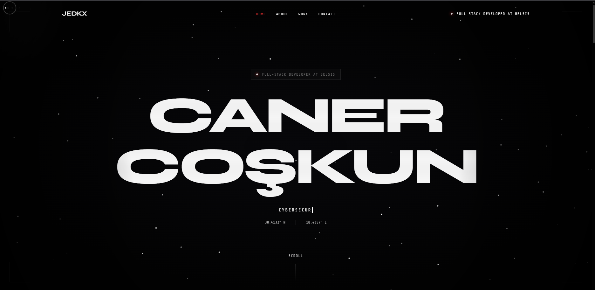

# J-Portfolio

Professional portfolio application built with React, TypeScript, and GSAP.  
The Projects section automatically loads public repositories from `jedkx` on GitHub. Employer case studies are excluded; a separate CV section links to the existing résumé.

## Why this exists

Most portfolio repositories look polished on the surface but fail to explain engineering decisions.  
This project is intentionally structured as a hiring-facing artifact: visual quality + explicit architecture + predictable runtime behavior.

The key design intent is simple:

- Auto-include public GitHub work so the portfolio stays fresh without manual updates.
- Keep the dark space/terminal identity while giving content more room.
- Fail safely: use the last saved repository list when available, or show a retry action.

## Live Demo

[View Portfolio](https://jedkx.github.io/J-Portfolio/)

## Preview Asset

The image below is a manually maintained preview; it is not regenerated by the build and may lag behind the local interface.



## Tech Stack

- React 19
- TypeScript
- Vite 7
- GSAP + ScrollTrigger
- Tailwind CSS
- Lucide React

## Key Features

- Automatic public GitHub repository feed with pagination and duplicate protection
- README preview detection with procedural SVG cover art when no image is available
- Thirty-minute browser cache and an explicit retry state for GitHub failures
- Independent chapters: full-screen particle playground → original terminal in normal document flow → a separate sticky repository gallery
- Short project steps (180–320 px), reversible masks and letter reveals, gentle settling after scroll, and depth-aware pointer motion; no terminal wheel interception
- GSAP Flip preview expansion, project index and previous/next controls
- Monochrome space/terminal identity: Syne headings, original ASCII/neofetch layout, and only the selected accent color
- Interactive spiral star field: adaptive density, accent-to-hot-blue thermal colors, pointer wakes and 10–15 second orbital charge with momentum-preserving bursts; no edge collision/wrapping or charge meter
- Original neofetch content without an inner scrollbar; persistent navigation; mobile gallery stacks visual and description vertically
- Contact station with email/copy action, CV link, Ankara local time, interactive signal ping and social links; the reference ribbon separates projects from Contact
- Smooth particle births, starting white and blending into the selected accent after the first interaction
- Optional discovery puzzle: five unmarked words in readable, non-link content; found keys are collected automatically without inline popups. A randomized receiver frequency unlocks a minimizable sonar that maps only visible, uncollected keys; it disappears at 5/5.
- Local passphrase access compares normalized input against SHA-256 digests. The accepted return phrase is intentionally shown after discovery; this client-side puzzle is not an authentication boundary.
- The face-only block resident appears behind a split-page reveal. Key discovery, passphrase access and repeat visits have different greetings. The loading resident starts blinking only after the seam opens; loading progress continues during the intrusion.
- Reload starts at Home. The full loading sequence plays on each visit, with a skip control and reduced-motion alternative.
- Responsive layouts, keyboard-accessible repository links and a static reduced-motion alternative
- CV links in the hero and Contact station
- GitHub Pages deployment pipeline

## Architecture Overview

Projects flow:

1. `useProjects` reads the last cached list, if present.
2. Public repositories are fetched from `https://api.github.com/users/jedkx/repos`, following pagination and sorting by recent pushes.
3. The mapper validates repository metadata and excludes Belsis-related entries.
4. Raw README files are checked for screenshot/preview images without additional REST API calls.
5. The UI renders the responsive list; failed requests keep cached content or offer retry. Fresh cache entries are reused for 30 minutes.

Core implementation files:

- `src/hooks/useProjects.ts`
- `src/lib/github.ts`
- `src/features/portfolio/RepositoryVisual.tsx`
- `src/features/portfolio/usePortfolioScene.ts`
- `src/features/portfolio/scene.ts`
- `src/lib/projectCache.ts`
- `src/lib/request.ts`
- `src/components/sections/PortfolioExperience.tsx`

## Local Development (Docker-first)

Prerequisites:

- Docker Desktop (or Docker Engine + Compose)

Run with Docker Compose:

```bash
docker compose up --build
```

Application URL:

- http://localhost:3000/J-Portfolio/

Stop:

```bash
docker compose down
```

## Local Development (Optional: Node.js)

If you prefer running without Docker:

- Node.js 22.12+ (Node 22 in CI/Docker; see `.nvmrc`)
- npm 10+

Install and run:

```bash
npm install
npm run dev
```

Production build:

```bash
npm run build
npm run preview
```

Quality checks:

```bash
npm run lint
npm run type-check
npm test
npm run build
```

## CI/CD

GitHub Actions workflow (`.github/workflows/deploy.yml`) runs:

- `npm ci`
- `npm run lint`
- `npm run type-check`
- `npm test`
- `npm run build`
- GitHub Pages deploy on `main`

## Operational Notes

- GitHub API integration is unauthenticated by default and may hit rate limits under heavy traffic.
- No token is shipped to the browser. GitHub failures use cached data when available; first-time offline visits show a retry and a direct GitHub link.
- Docker setup is optimized for local development parity, not production container hosting.

## Future Hardening

- Consider a server-side GitHub proxy if traffic outgrows anonymous API limits.
- Add repository whitelist/blacklist controls to tune auto-import behavior.
- Pull requests run quality gates without deploying (`.github/workflows/quality.yml`).

## Project Structure

```text
src/
├── components/          # UI composition and sections
├── constants/           # Static content and app constants
├── features/portfolio/  # Scene lifecycle, geometry and repository visuals
├── hooks/               # React hooks (including project sync hook)
├── lib/                 # Validated data/cache boundaries and bounded requests
├── styles/              # Base, legacy layers and scoped feature styles
├── types/               # TypeScript models
└── utils/               # Shared helpers
```

See [runtime architecture and remaining debt](docs/architecture.md) and [senior audit](docs/senior-audit.md).
For the current interaction behavior and manual checks, see [interaction guide](docs/interactions.md). Audit reports describe historical snapshots, not guarantees about later revisions.

## License

MIT
